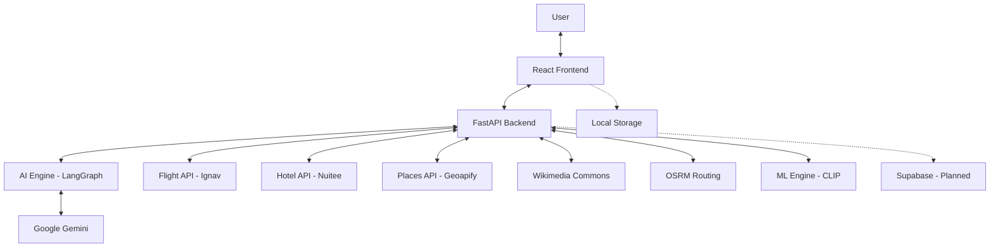

# 🧭 Pravasa – AI-Powered Virtual Travel Agent


**Pravasa** is an AI-powered virtual travel agent designed to simplify travel planning across India. It combines conversational AI, real-time travel discovery, intelligent itinerary generation and budget management into one platform.

Our goal is to provide travellers with a unified platform to discover destinations, explore flights and hotels, plan sightseeing activities and organise complete trips.

---

## 🚀 Key Features

- **AI Travel Assistant:** Understands travel requirements through natural language conversations.
- **Smart Travel Planning:** Extracts destinations, dates, budgets and traveller preferences.
- **Pan-India Destination Selection:** Supports destination discovery across all 28 Indian States and 8 Union Territories.
- **Flight Discovery:** Searches available flights and provides airline booking redirections.
- **Hotel Discovery:** Searches hotels, room types, amenities and available rates.
- **Places to Visit:** Discovers tourist attractions, museums and historical landmarks.
- **Smart Itinerary Generation:** Organises activities into morning, afternoon and evening schedules.
- **Budget Management:** Tracks estimated expenses across flights, hotels, transportation and sightseeing.
- **Trip Management:** Saves travel plans for future access.
- **Itinerary Replanning:** Allows users to modify and reorganise their travel plans.

## 🛠️ Technology Stack

| Category | Technologies |
|---|---|
| Frontend | React 19, TypeScript, Vite |
| Styling | Tailwind CSS 4 |
| Backend | Python, FastAPI |
| AI Orchestration | LangGraph |
| AI Model | Google Gemini |
| Machine Learning | PyTorch, Hugging Face Transformers, CLIP |
| Data Validation | Pydantic |
| Database (Planned) | Supabase PostgreSQL |
| Testing | Pytest, Pytest-Asyncio |
| Version Control | Git, GitHub |

## 🌐 APIs & External Integrations

| API / Service | Purpose | Status |
|---|---|---|
| Google Gemini API | AI conversations, intent extraction and itinerary synthesis | Integrated |
| Ignav API | Flight discovery | Integrated |
| Nuitee Connect (LiteAPI) | Hotel search and rate pre-booking | Integrated |
| Geoapify API | Geocoding and tourist places discovery | Integrated |
| Wikimedia Commons API | Tourist attraction photographs | Integrated |
| OSRM | Road distance and travel time calculation | Integrated |
| Amadeus API | Alternative travel inventory provider | Not Implemented |
| Supabase | Cloud database and user authentication | Planned |

*Integration status describes the current implementation, not necessarily live production availability. Some services use fallback data when credentials or providers are unavailable.*

## 🏗️ System Architecture

Pravasa follows a modular architecture consisting of a React frontend, FastAPI backend, AI workflows, machine learning services and external travel APIs.



## 📁 Project Structure

```text
travel-agentic/
│
├── ai_engine/          # AI prompts, services and workflows
├── backend/            # FastAPI backend and REST APIs
├── database/           # Database schemas and migrations
├── docs/               # Project documentation
├── frontend/           # React + TypeScript application
├── integrations/       # External API clients and mock data
├── logo/               # Project branding and logos
├── ml_engine/          # Machine learning modules
├── scratch/            # Experimental development files
├── tests/              # Automated testing
│
├── .env.example        # Environment configuration template
├── pyproject.toml      # Python project configuration
└── README.md           # Project documentation
```

## 📊 Development Progress

| Module | Status | Progress |
|---|---|---|
| Frontend Development | Completed | 6-step guided travel workflow |
| Backend Development | Completed | FastAPI endpoints and services |
| AI Engine | Completed | LangGraph workflows and Gemini integration |
| ML Engine | Partially Completed | CLIP image verification |
| Flight Integration | Integrated | Ignav API |
| Hotel Integration | Integrated | Nuitee LiteAPI |
| Places Integration | Integrated | Geoapify and Wikimedia |
| Road Routing | Integrated | OSRM |
| Database | Pending | Supabase implementation |
| Automated Testing | Completed | 383 reported passing tests |
| Deployment | Pending | Cloud deployment |

### ✅ Work Completed

- Developed the React-based travel planning interface.
- Implemented the six-step guided travel workflow.
- Integrated conversational AI using LangGraph and Gemini.
- Implemented travel intent extraction and clarification workflows.
- Integrated flight and hotel discovery services.
- Integrated tourist attraction discovery and image retrieval.
- Implemented itinerary generation and replanning.
- Developed budget calculation and validation.
- Implemented local trip saving using browser localStorage.
- Created automated backend and AI workflow tests.

### 🔄 Work In Progress

- Round-trip flight discovery.
- Multi-city itinerary improvements.
- Railway schedule integration research.
- Offline capability and PWA support.
- Further AI workflow improvements.

### 📌 Pending Work

- Implement Supabase database and user authentication.
- Enable cloud-based trip storage and synchronisation.
- Complete hotel payment gateway integration.
- Implement additional real-time travel information.
- Improve end-to-end testing.
- Implement Docker and CI/CD pipelines.
- Deploy the frontend and backend.

## ⚙️ Installation & Setup

### Prerequisites

- Python 3.11+
- Node.js 18+
- Git

### 1. Clone the Repository

```bash
git clone https://github.com/knvijaykumar/travel-agentic.git
cd travel-agentic
```

### 2. Backend Setup

```bash
python -m venv .venv
```

Activate the environment:

**Windows:**
```bash
.\.venv\Scripts\Activate.ps1
```

**Install dependencies:**
```bash
pip install -r backend/requirements.txt
```

Configure environment variables:

```bash
copy backend\.env.example backend\.env
```

Add the required API credentials to `backend/.env`.

Start the backend:

```bash
uvicorn backend.app.main:app --reload --port 8000
```

Backend documentation: http://localhost:8000/docs

### 3. Frontend Setup

Open another terminal:

```bash
cd frontend
npm install
```

Configure environment variables:

```bash
copy .env.example .env
```

Start the frontend:

```bash
npm run dev
```

Frontend URL: http://localhost:5173

### 4. Run Tests

From the project root:

```bash
pytest -v
```

For frontend build verification:

```bash
cd frontend
npm run build
```

## ⚠️ Current Limitations

- Flight booking is completed through external airline redirections; Pravasa does not issue flight tickets or PNRs.
- Hotel rate pre-booking is implemented, but final payment processing is pending.
- Saved trips currently use browser localStorage.
- Supabase cloud database synchronisation is not yet implemented.
- External API availability and quotas can affect live results.
- Some integrations have fallback reference data.

## 🔮 Future Scope

- Multilingual and voice-based AI travel assistance.
- Real-time weather and travel alerts.
- Autonomous itinerary modification.
- Group trip planning and collaboration.
- Railway and additional transport integrations.
- Cloud-based user accounts and trip synchronisation.
- Production deployment and scalability improvements.

## 📌 Project Information

| Detail | Information |
|---|---|
| Project Name | Pravasa – AI-Powered Virtual Travel Agent |
| Project Type | AI + Full-Stack Web Application |
| Primary Focus | Intelligent Travel Planning |
| Development Status | Active Development |
| Repository | [GitHub – travel-agentic](https://github.com/knvijaykumar/travel-agentic) |
| Main Branch | `main` |

---

**Pravasa — Plan with confidence. Explore with curiosity. Travel smart.** 🇮🇳
