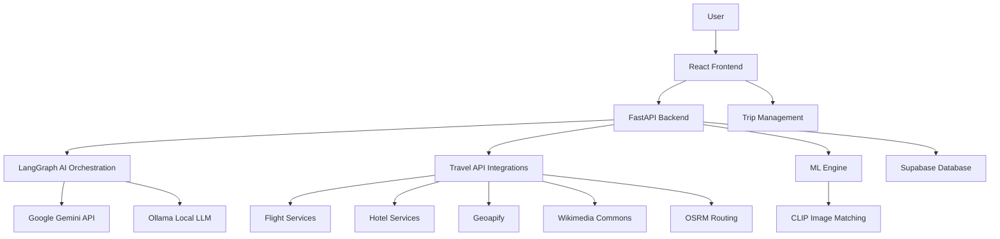

# Pravasa – AI-Powered Virtual Travel Agent

An intelligent virtual travel assistant that helps users plan personalised trips, discover destinations, compare travel options and generate itineraries using AI and travel APIs.

## Key Features

- AI-powered travel conversation and intent extraction
- Guided trip-planning workflow
- Flight and hotel search
- Destination and tourist-place discovery
- Location-based recommendations
- Place images and information
- Route planning and distance calculation
- Budget estimation and itinerary generation
- Itinerary modification and replanning
- Save and manage trips

## Technology Stack

| Component | Technology |
|---|---|
| Frontend | React, TypeScript, Vite |
| Styling | Tailwind CSS |
| Backend | Python, FastAPI |
| AI Orchestration | LangGraph |
| Cloud LLM | Google Gemini |
| Local LLM Runtime | Ollama |
| Machine Learning | PyTorch, Transformers, CLIP |
| Database | Supabase (planned) |
| Routing | OSRM |
| Version Control | Git, GitHub |

## APIs and Integrations

| API / Service | Purpose |
|---|---|
| Google Gemini API | AI-powered conversations and travel planning |
| Ollama | Local execution of open-source LLMs |
| Ignav | Travel-related integration |
| Nuitee LiteAPI | Hotel search and related services |
| Geoapify | Geocoding and location discovery |
| Wikimedia Commons | Destination images |
| OSRM | Route calculation |
| Amadeus | Flight integration / evaluation |

### AI Model Support

Pravasa is designed to support two AI execution options:

- **Google Gemini:** Cloud-based LLM for AI-powered travel assistance.
- **Ollama:** Local LLM runtime for running supported open-source models on a local machine.

Ollama can provide an alternative to cloud-based inference. Its actual availability depends on local model installation and backend integration.

## System Architecture



*Note: Gemini and Ollama represent alternative AI execution options. Supabase and any integrations not yet implemented are planned components.*

## Project Structure

```text
travel-agentic/
├── ai_engine/
├── backend/
├── database/
├── docs/
├── frontend/
├── integrations/
├── logo/
├── ml_engine/
├── scratch/
├── tests/
├── .env.example
├── .gitignore
├── pyproject.toml
└── README.md
```

## Development Progress

| Module | Status |
|---|---|
| Frontend development | Completed |
| Backend development | Completed |
| AI travel assistant | Implemented |
| LangGraph orchestration | Implemented |
| Gemini integration | Implemented |
| Ollama local LLM | Planned / integration in progress |
| Flight integration | Partially implemented |
| Hotel integration | Implemented |
| Location and places discovery | Implemented |
| Image integration | Implemented |
| Route calculation | Implemented |
| ML image matching | Partially implemented |
| Database integration | Pending |
| Deployment | Pending |

## Completed Work

- Developed the React-based frontend.
- Implemented FastAPI backend services.
- Built AI-powered travel conversation and intent extraction.
- Integrated LangGraph for AI workflow orchestration.
- Integrated travel-related APIs.
- Implemented destination discovery and itinerary generation.
- Added route calculation and budget estimation.
- Implemented trip management using local storage.
- Created automated tests for project functionality.

## Work in Progress

- Improving flight search and integration.
- Enhancing itinerary generation and replanning.
- Evaluating local LLM support through Ollama.
- Improving AI model selection and fallback handling.

## Pending Work

- Complete Ollama integration and local model testing.
- Implement Supabase database and authentication.
- Implement cloud-based trip synchronisation.
- Improve round-trip and multi-city travel support.
- Add weather integration.
- Implement deployment and CI/CD.
- Explore offline/PWA support.

## Setup Instructions

### 1. Clone the Repository

```bash
git clone https://github.com/knvijaykumar/travel-agentic.git
cd travel-agentic
```

### 2. Backend Setup

```bash
python -m venv .venv
```

Activate the environment and install dependencies:

```bash
pip install -e .
```

Start the backend using the project's configured FastAPI entry point.

### 3. Frontend Setup

```bash
cd frontend
npm install
npm run dev
```

### 4. Run Tests

```bash
pytest
```

### 5. Local LLM Setup (Ollama)

Install Ollama and download a supported model:

```bash
ollama pull llama3.2
```

Start the Ollama service:

```bash
ollama serve
```

The backend must be configured to communicate with the local Ollama API before local inference is available.

## Current Limitations

- Flight booking is handled through external airline or travel-provider redirects.
- No PNR generation or verification is implemented.
- Hotel payment processing is not fully implemented.
- Trip data currently uses local storage.
- Supabase integration is pending.
- API availability and quotas may affect results.
- Ollama functionality depends on local installation and backend integration.

## Future Scope

- Complete local LLM integration using Ollama.
- Support additional open-source language models.
- Improve AI-powered personalised recommendations.
- Implement persistent cloud storage and user authentication.
- Expand travel-provider integrations.
- Deploy the platform for public access.

## Repository

GitHub: https://github.com/knvijaykumar/travel-agentic

**Project:** Pravasa – AI-Powered Virtual Travel Agent
