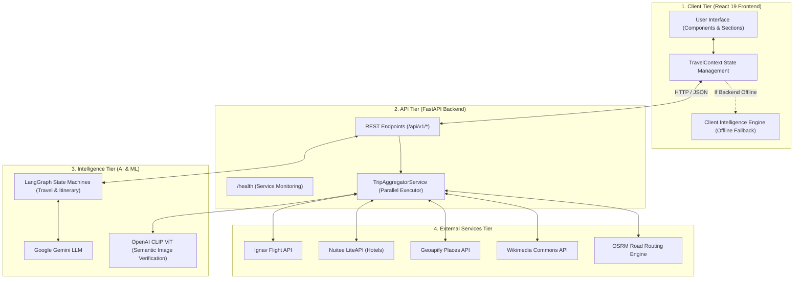

# 🧭 Pravasa – AI-Powered Virtual Travel Agent

[](https://github.com/knvijaykumar/travel-agentic)
[](https://react.dev)
[](https://fastapi.tiangolo.com)
[](https://ai.google.dev)
[](https://pytest.org)
[](LICENSE)

> **Welcome to Pravasa!** This README serves as our **central project documentation and team progress tracker**. Whether you are working on frontend components, backend services, AI workflows, or testing, this guide outlines what we are building, what is already working, what is currently in progress, and what tasks remain.

---

## 📑 Table of Contents

1. [Project Introduction](#1-project-introduction)
2. [Project Features](#2-project-features)
3. [Technology Stack](#3-technology-stack)
4. [APIs and External Integrations](#4-apis-and-external-integrations)
5. [Project Architecture](#5-project-architecture)
6. [Project Structure](#6-project-structure)
7. [Work Completed So Far](#7-work-completed-so-far)
8. [Current Development Progress Tracker](#8-current-development-progress-tracker)
9. [Work Currently in Progress](#9-work-currently-in-progress)
10. [Pending Work & Future Tasks](#10-pending-work--future-tasks)
11. [How the Complete System Works (User Journey)](#11-how-the-complete-system-works-user-journey)
12. [Running the Project Locally](#12-running-the-project-locally)
13. [Current Limitations](#13-current-limitations)
14. [Future Scope](#14-future-scope)
15. [Repository Information](#15-repository-information)

---

## 1. Project Introduction

### What is Pravasa?
**Pravasa** (प्रवास — Sanskrit for *Journey* or *Travel*) is an AI-powered virtual travel agent designed specifically for travel across India. It combines conversational artificial intelligence with real-world travel inventories (flights and hotels), points of interest, driving routes, and strict budget controls into a single, cohesive web platform.

### What Problem Are We Solving?
Planning a vacation in India today is fragmented, time-consuming, and frustrating:
- **Too Many Disconnected Apps**: Travellers have to browse airline websites, hotel portals, sightseeing blogs, map services, and cab aggregators separately.
- **Unrealistic Schedules**: Itineraries created online often ignore real driving times, traffic bottlenecks, and geographic distances.
- **Budget Uncertainty**: It is difficult to balance flights, accommodations, local cabs, and sightseeing costs in real time.
- **Lack of Nationwide Coverage**: Most travel planners focus on a few popular tourist spots (like Goa or Golden Triangle) while neglecting complete pan-India discovery.

### What is Our Proposed Solution?
Pravasa acts as an intelligent, unified travel companion:
1. **Talk or Type Naturally**: Users can describe what they want in plain English (e.g., *"Plan a 5-day family trip to Kerala in December with cultural sites and good vegetarian food under ₹50,000"*).
2. **Deterministic Constraint Control**: The platform guarantees that recommendations respect actual dates, real driving transit times, and budget limits.
3. **Genuine Nationwide Coverage**: Built with verified destinations, airports, and landmarks across all **28 Indian States and 8 Union Territories**.
4. **Authentic Provider Redirections**: Transparent booking links redirecting to real airline portals (such as IndiGo) and LiteAPI hotel rate locking, strictly avoiding fake PNRs or synthetic booking confirmations.

### How Does a User Interact with Pravasa?
1. **Interactive Search & Setup**: Choose starting city and destination from searchable pan-India autocompletes, pick dates, and specify budget.
2. **Conversational Assistant**: Open the AI drawer anytime to adjust preferences, ask questions, or request refinements in natural language.
3. **Step-by-Step Curation**: Review available flights, pick verified hotels, select sightseeing attractions, and see an automated day-by-day schedule.
4. **Real-Time Budget Meter**: Watch the total trip cost update live as choices are made, with warnings if costs approach or exceed budget caps.

---

## 2. Project Features

| Feature | Category | Status | Description |
| :--- | :--- | :--- | :--- |
| **Conversational AI Assistant** | AI / NLP | **Completed** | Multi-turn conversational side-drawer powered by LangGraph state machines and Google Gemini. Understands preferences, answers questions, and suggests trip modifications. |
| **Travel Intent Detection** | AI / Extraction | **Completed** | Extracts structured details (destination, dates, travellers, budget, transport mode) from natural language without inventing missing facts. |
| **Pan-India Destination Selection** | Core Geographic | **Completed** | Full support for all **28 Indian States and 8 Union Territories**. Autocomplete provides cities, tourist regions, and valid IATA airport codes. |
| **Guided 6-Step Travel Workflow** | UI / UX | **Completed** | Structured progressive workflow: Requirements -> Flights -> Hotels -> Sightseeing -> Itinerary -> Trip Review. |
| **Flight Discovery & Deep-Linking** | Transport | **Completed** | Live flight queries via Ignav API with airline fares, timings, stops, and safe redirection to official airline portals (e.g., IndiGo). **Zero fake PNRs.** |
| **Hotel Discovery & Rate Locking** | Lodging | **Completed** | Integration with Nuitee Connect (LiteAPI) for live hotel search, room rates, amenity lists, and two-step `/prebook` rate locking. |
| **Sightseeing & Places Discovery** | Places / Geo | **Completed** | Geoapify Places API integration querying tourist attractions, cultural landmarks, and heritage sites by geographic radius. |
| **Authentic Wikimedia Photos** | Visuals / Media | **Completed** | Automatic retrieval of Creative Commons photos with location-conflict heuristics to reject irrelevant or misleading imagery. |
| **Semantic Image Verification (CLIP)** | Vision ML | **Completed (Optional)** | OpenAI CLIP ViT model that mathematically compares place descriptions to candidate photos. Engineered to be optional so lightweight environments run smoothly. |
| **Smart Road Routing (OSRM)** | Navigation | **Completed** | Open Source Routing Machine integration calculating real driving distances and transit minutes between stops, with Haversine fallback. |
| **Strict Total Budget Control** | Finance | **Completed** | Live cost tallying across flights, hotels, transit, and entry fees with color-coded status badges (`OPTIMAL`, `APPROACHING_LIMIT`, `OVER_BUDGET`). |
| **Itinerary Generation & Replanning** | Scheduling | **Completed** | Automatic morning/afternoon/evening activity slots, travel time estimations, and the ability to reorder activities or swap days. |
| **Trip Management ("My Trips")** | Persistence | **Completed** | Save complete travel plans locally (`localStorage`) with full card view, budget breakdown, and offline viewing. |
| **Database Synchronization** | Database | **Planned** | Server-side user accounts, saved itineraries, and multi-device cloud synchronization using Supabase PostgreSQL. |

---

## 3. Technology Stack

| Category | Technology | Version | Purpose in Pravasa |
| :--- | :--- | :--- | :--- |
| **Frontend Framework** | **React** | `19.2.0` | Modern component architecture, state management, and UI rendering |
| **Frontend Bundler** | **Vite** | `7.1.12` | Ultra-fast local development server and optimized production build tool |
| **Language (Frontend)**| **TypeScript** | `5.9.3` | Type-safety, clean data models, and compile-time contract verification |
| **Styling & Design** | **Tailwind CSS** | `4.1.16` | Utility-first responsive design, modern cards, and color-coded meters |
| **Icons** | **Lucide React** | `0.548.0` | Consistent, accessible iconography throughout the application |
| **Backend Framework** | **FastAPI** | `>=0.111.0` | High-performance asynchronous Python REST API framework |
| **ASGI Web Server** | **Uvicorn** | `>=0.30.0` | Asynchronous server running our FastAPI application (`port 8000`) |
| **Language (Backend)** | **Python** | `>=3.11` | Core backend logic, numerical calculations, and AI agent coordination |
| **Data Validation** | **Pydantic** | `>=2.7.0` | Request/response schema validation and data sanitization |
| **Configuration** | **Pydantic Settings** | `>=2.3.0` | Secure environment variable parsing from `.env` files |
| **AI Orchestration** | **LangGraph** | `>=0.2.0` | Multi-turn stateful conversational workflows and pipeline execution |
| **LLM Provider** | **Google GenAI SDK** | `>=1.0.0` | Gemini 3.8 Flash / 3.1 Flash-Lite for natural language parsing and itinerary synthesis |
| **Vision ML (Optional)**| **PyTorch & Transformers** | `>=2.2.0` / `>=4.40.0` | OpenAI CLIP ViT model for semantic image relevance verification |
| **Testing Suite** | **Pytest & Pytest-Asyncio** | `>=8.2.0` / `>=0.23.0` | Automated test runner with 383 unit and integration test cases |
| **Database (Planned)** | **Supabase PostgreSQL** | *Scaffolded* | Cloud database for authentication, trip storage, and user profiles |

---

## 4. APIs and External Integrations

To help all team members understand our data sources, here is every external API integrated into Pravasa:

### Detailed API Breakdown

1. **Google Gemini API** (`gemini-3.8-flash` / `gemini-3.1-flash-lite`)
   - **What it does**: Parses raw natural language into structured data and writes day-by-day travel narratives.
   - **Where used**: `ai_engine/services/intent_extractor.py` and `itinerary_synthesizer.py`.
   - **Status**: **Fully Implemented**. Uses real `GEMINI_API_KEY`. If key is missing or quota is exceeded, falls back smoothly to our deterministic client engine.

2. **Ignav Flight API** (`https://ignav.com/api`)
   - **What it does**: Searches live domestic flights across origin/destination airports, dates, and cabin classes.
   - **Where used**: `backend/app/services/ignav_service.py` and `/api/v1/flights/search`.
   - **Status**: **Fully Implemented**. Uses real `IGNAV_API_KEY`. Provides verified airline redirects (IndiGo portal). Falls back to reference flight schedules if unconfigured.

3. **Nuitee Connect (LiteAPI)** (`https://api.liteapi.travel/v3.0`)
   - **What it does**: Searches real hotel inventory, room types, amenities, and provides rate pre-booking (`/prebook`).
   - **Where used**: `backend/app/services/nuitee_service.py`, `/api/v1/hotels/search`, and `/api/v1/bookings/hotels/prebook`.
   - **Status**: **Fully Implemented**. Works in both Sandbox and Live Production modes via `NUITEE_API_KEY`.

4. **Geoapify Places & Geocoding API** (`https://api.geoapify.com`)
   - **What it does**: Converts city names to GPS coordinates and discovers tourist sights, museums, and historical landmarks within a given radius.
   - **Where used**: `backend/app/services/geoapify_service.py` and `/api/v1/places/search`.
   - **Status**: **Fully Implemented**. Uses real `GEOAPIFY_API_KEY`.

5. **Wikimedia Commons API** (`https://commons.wikimedia.org`)
   - **What it does**: Retrieves genuine, Creative Commons-licensed photographs for attractions and cultural sites.
   - **Where used**: `backend/app/services/wikimedia_service.py`.
   - **Status**: **Fully Implemented**. Public API (no key required). Uses location-filtering heuristics to reject mismatched photos.

6. **Open Source Routing Machine (OSRM)** (`https://router.project-osrm.org`)
   - **What it does**: Calculates realistic road driving distances and transit times between consecutive stops.
   - **Where used**: `backend/app/services/routing_service.py`.
   - **Status**: **Fully Implemented**. Public API with mathematical Haversine formula fallback.

7. **Amadeus Travel API** *(Configured / Placeholder)*
   - **What it does**: Alternative global distribution system for flights and hotels.
   - **Status**: **Not Implemented**. Config keys exist in `.env.example`, but active flight/hotel traffic is handled by Ignav and Nuitee.

8. **Supabase PostgreSQL** *(Configured / Scaffolding)*
   - **What it does**: Planned database for user accounts and cloud trip storage.
   - **Status**: **Pending Implementation**. Directory scaffolding exists in `database/`; current storage uses `localStorage`.

---

## 5. Project Architecture

The application is built on a clear separation of concerns across four main tiers:



### Communication Flow
1. **Frontend to Backend**: The React frontend talks to FastAPI via standard asynchronous JSON requests over HTTP (`http://localhost:8000/api/v1`).
2. **Health Check & Auto-Recovery**: The frontend monitors `/api/v1/health`. If the backend starts after the frontend, the frontend automatically recovers connection using bounded exponential backoff without spamming the server.
3. **Data Aggregation**: When generating a trip, `TripAggregatorService` uses Python thread pools to query flights, hotels, places, and driving routes in parallel, cutting response times from ~15 seconds to under 3 seconds.
4. **Resilient Fallback**: If any external provider is unreachable or unconfigured, Pravasa automatically falls back to curated reference datasets and client-side scheduling.

---

## 6. Project Structure

Here is a simplified directory map of the codebase:

```text
travel-agentic/
├── ai_engine/                         # AI workflows, prompts, and LangGraph graphs
│   ├── prompts/                       # Gemini prompt templates (intent extraction & itinerary)
│   ├── services/                      # AI adapters (conversation manager, synthesizer)
│   └── workflows/                     # LangGraph state machine definitions
│
├── backend/                           # FastAPI backend server
│   ├── app/
│   │   ├── api/v1/endpoints/          # Domain REST endpoints (chat, flights, hotels, places, etc.)
│   │   ├── core/                      # Configuration, settings, and logging
│   │   ├── schemas/                   # Pydantic data schemas (DTOs)
│   │   ├── services/                  # Business logic and external API clients
│   │   └── main.py                    # FastAPI entrypoint and CORS configuration
│   ├── .env.example                   # Backend environment template
│   └── requirements.txt               # Backend Python dependencies
│
├── database/                          # Database schemas and migrations (scaffolding)
│   ├── migrations/                    # SQL migration scripts (.gitkeep)
│   ├── schemas/                       # Database table definitions (.gitkeep)
│   └── seed/                          # Default seed data (.gitkeep)
│
├── frontend/                          # React 19 + TypeScript + Vite web app
│   ├── src/
│   │   ├── assets/                    # Pravasa brand logos and graphical badges
│   │   ├── components/
│   │   │   ├── common/                # Shared UI (Header, AI Drawer, BrandLogo, Autocomplete)
│   │   │   ├── plan/                  # Pan-India origin and destination selector dropdowns
│   │   │   └── sections/              # Guided 6-step wizard sections (Flights, Hotels, etc.)
│   │   ├── context/                   # Central state management (TravelContext.tsx)
│   │   ├── data/                      # Pan-India data (28 states, 8 UTs, airports, cities)
│   │   ├── services/                  # Backend API client (apiClient.ts)
│   │   ├── types/                     # TypeScript interfaces and data types
│   │   └── utils/                     # Budget calculator and client itinerary engine
│   ├── .env.example                   # Frontend environment template
│   └── package.json                   # NPM package dependencies and scripts
│
├── integrations/                      # Base client abstractions and mock fixtures
│   ├── mocks/                         # Reference JSON test payloads
│   └── base_client.py                 # Asynchronous base HTTP client
│
├── ml_engine/                         # Machine learning package scaffolding
├── tests/                             # Comprehensive test suites (383 test cases)
│   ├── ai_engine/                     # AI workflow and intent extraction tests
│   └── backend/                       # Endpoint, service, schema, and validation tests
│
├── pyproject.toml                     # Python package metadata and pytest settings
└── README.md                          # Central project documentation (this file)
```

---

## 7. Work Completed So Far

### 🎨 Frontend Development
- [x] **React 19 & Tailwind CSS 4 Migration**: Clean, modern component architecture styled with responsive Tailwind CSS utilities.
- [x] **6-Step Guided Travel Wizard**: Implemented step-by-step flow (Requirements -> Flights -> Hotels -> Sightseeing -> Itinerary -> Review).
- [x] **Pan-India Coverage**: Verified database covering all **28 Indian States and 8 Union Territories** with capitals, major cities, airports, and authentic tourist spots.
- [x] **Conversational AI Drawer**: Slide-out assistant drawer with natural language chat, quick-suggestion chips, and trip parameter updates.
- [x] **Real-Time Budget Meter**: Instant calculation of total and per-person costs with visual status alerts (`OPTIMAL`, `APPROACHING_LIMIT`, `OVER_BUDGET`).
- [x] **Interactive Itinerary Viewer**: Day-by-day morning/afternoon/evening activity cards with transit durations, cab indicators, and day reordering.
- [x] **Local Trip Persistence**: Complete "My Trips" dashboard storing saved itineraries in browser `localStorage`.
- [x] **Smart Backend Recovery**: Replaced single-shot health checks with bounded exponential backoff (`5s -> 10s -> 20s -> 30s`) and tab focus listeners.
- [x] **Zero Premature Requests**: Eliminated unprompted backend API queries on initial page load before the user enters a destination.

### ⚙️ Backend Development
- [x] **FastAPI REST API**: High-speed asynchronous server with modular domain endpoints under `/api/v1`.
- [x] **Pydantic Validation**: Comprehensive DTO schemas for flights, hotels, places, bookings, chat, and itineraries.
- [x] **Parallel Data Aggregator**: Implemented `TripAggregatorService` using thread pools to fetch flights, hotels, places, and routes concurrently.
- [x] **CORS Configuration**: Secure cross-origin resource sharing allowing local frontend origins (`localhost:5173`, `127.0.0.1:5173`).

### 🤖 AI Engine & Workflows
- [x] **LangGraph Conversational Workflow**: Multi-turn `TravelWorkflow` managing conversational sessions, clarification policies, and missing field detection.
- [x] **Gemini Intent Extraction**: Structured extraction of destination, dates, budget, and travel preferences from natural text.
- [x] **LangGraph Itinerary Workflow**: Multi-step pipeline aggregating provider data and synthesizing timed, narrative itineraries.
- [x] **Clarification Policy**: Intelligent prioritization that asks only one clear question at a time when essential fields are missing.

### 🌐 API Integrations & Services
- [x] **Ignav Flight Search**: Real-time flight search across origin/destination airports with verified airline deep-links.
- [x] **Removal of Fake PNRs**: Strict elimination of fake PNR capture and simulated tickets; users are redirected directly to real airline portals (e.g., IndiGo).
- [x] **Nuitee LiteAPI Hotels**: Live hotel rates, amenity details, cancellation policies, and two-step `/prebook` rate locking.
- [x] **Geoapify Places**: Radius-based search for tourist sights, museums, and historical landmarks.
- [x] **Wikimedia Photo Enrichment**: Automated retrieval of authentic Creative Commons photos with location-conflict heuristics.
- [x] **Optional CLIP ML Verification**: Semantic verification comparing place descriptions with photos; gracefully skips if ML packages are omitted.
- [x] **OSRM Road Routing**: Real driving distances and transit durations between attractions with Haversine fallback.

### 🧪 Testing & Stability
- [x] **383 Automated Pytest Tests**: Comprehensive test coverage across backend endpoints, AI workflows, and external service clients.
- [x] **Typecheck & Build Validation**: Both `tsc -b` and Vite production build pass cleanly with zero errors.

---

## 8. Current Development Progress Tracker

| Module | Current Status | Completed Work | Remaining Work |
| :--- | :--- | :--- | :--- |
| **Frontend UI** | **Completed** | Full 6-step travel wizard, Pan-India selectors, AI drawer, responsive layout, budget meter. | Fine-tune mobile drawer animations and polish dark mode. |
| **Backend API** | **Completed** | Core FastAPI setup, versioned v1 routes, Pydantic schemas, parallel aggregator. | Add API rate-limiting middleware and JWT authentication. |
| **AI Engine** | **Completed** | LangGraph conversation workflows, Gemini intent extraction, clarification policy. | Enhance prompt templates for multi-city road trips. |
| **ML Engine** | **Partially Completed** | CLIP ViT semantic photo verification working in `backend/app/services/clip_service.py`. | Implement constraint knapsack optimization in `ml_engine/`. |
| **Flight Integration**| **Completed** | Live Ignav flight search, airline branding, direct external booking redirects. | Add return-flight round-trip search support. |
| **Hotel Integration** | **Completed** | Nuitee LiteAPI search, room selection, amenities, `/prebook` rate locking. | Connect live payment gateway for post-prebook checkouts. |
| **Places Integration**| **Completed** | Geoapify POI search + Wikimedia authentic images with location heuristics. | Add user review scores and opening hours verification. |
| **Database** | **Pending** | Scaffolding directories created in `database/`. | Implement Supabase PostgreSQL tables and migration scripts. |
| **Testing** | **Completed** | 383 automated pytest test cases + frontend production build checks passing. | Add end-to-end browser automation tests (Playwright). |
| **Deployment** | **Pending** | Configured and running smoothly in local development environment. | Setup Docker containerization and cloud deployment pipelines. |

---

## 9. Work Currently in Progress

Here are the specific tasks our team is actively tackling:

1. **Round-Trip Flight Discovery**: Extending `backend/app/api/v1/endpoints/flights.py` and `frontend/src/components/sections/FlightsSection.tsx` to display paired return flights when a return date is selected.
2. **Multi-City Itinerary Chaining**: Enhancing the LangGraph itinerary workflow to generate connected schedules across multiple destinations (e.g., Delhi -> Agra -> Jaipur).
3. **Live Railway Schedule Exploration**: Investigating public IRCTC / Indian Railways APIs to augment our current static reference schedules (`trainsData.ts`).
4. **Offline Capability & PWA Support**: Adding service worker caching for destination guides so users can view their itineraries without active internet.

---

## 10. Pending Work & Future Tasks

Below is our roadmap checklist of remaining work for upcoming development sprints:

### 🗄️ Database & User Accounts
- [ ] Create Supabase PostgreSQL schema for `users`, `saved_trips`, and `booking_records`.
- [ ] Implement database migration scripts under `database/migrations/`.
- [ ] Replace browser `localStorage` with server-side database synchronization.
- [ ] Add user authentication (Email/Password & Google OAuth).

### 💳 Payments & Booking Settlement
- [ ] Integrate Razorpay or Cashfree Sandbox for hotel pre-booking payments.
- [ ] Issue digital booking vouchers and PDF receipts upon payment confirmation.

### 🌦️ Real-Time Context
- [ ] Integrate OpenWeatherMap / IMD API for real-time destination weather advisories.
- [ ] Display seasonal advice (e.g., best months to visit Ladakh vs. Kerala during monsoon).

### 🚀 Production Deployment & DevOps
- [ ] Author `Dockerfile` for the FastAPI backend and multi-stage `Dockerfile` for the React frontend.
- [ ] Create `docker-compose.yml` for unified one-command local startup.
- [ ] Configure CI/CD GitHub Actions pipeline to run `pytest` and `npm run build` on every pull request.
- [ ] Deploy backend to Google Cloud Run / Render and frontend to Vercel.

---

## 11. How the Complete System Works (User Journey)

Here is how a user experiences Pravasa from start to finish:

```text
[1. User Enters Requirements]
       │
       ▼
   User selects Origin (e.g., "Bengaluru"), Destination (e.g., "Jaipur"), 
   Travel Dates, Travellers, Accommodation Tier (Standard), and Budget (₹40,000).
       │
       ▼
[2. Parallel Backend Discovery]
       │
       ├── Ignav API finds commercial flights (e.g., IndiGo 6E-205, ₹9,800).
       ├── Nuitee LiteAPI finds hotels matching tier (e.g., Heritage Haveli, ₹2,800/night).
       ├── Geoapify & Wikimedia discover top attractions with verified photos.
       └── OSRM computes driving times between all points of interest.
       │
       ▼
[3. Step-by-Step Customization]
       │
       ├── User selects flight -> clicks "Book on Airline Website" (opens IndiGo deep-link).
       ├── User selects hotel -> rate is temporarily locked via LiteAPI /prebook.
       └── User toggles desired attractions (Hawa Mahal, Amber Fort, City Palace).
       │
       ▼
[4. Day-by-Day Itinerary Synthesis]
       │
       ▼
   Gemini AI & LangGraph organize selected stops into realistic Morning, Afternoon, 
   and Evening slots, factoring in driving transit durations and opening hours.
       │
       ▼
[5. Review, Budget Validation & Save]
       │
       ▼
   Budget meter verifies total cost is under ₹40,000. 
   User saves trip to "My Trips" for offline access.
```

---

## 12. Running the Project Locally

Follow these step-by-step instructions to run Pravasa on your development machine:

### Prerequisites
- **Python**: Version `3.11` or higher
- **Node.js**: Version `18.x` or higher
- **Git**

---

### Step 1: Clone the Repository
```bash
git clone https://github.com/knvijaykumar/travel-agentic.git
cd travel-agentic
```

---

### Step 2: Set Up & Run the Backend

1. **Create and activate a Python virtual environment:**
   ```bash
   # On Windows (PowerShell):
   python -m venv .venv
   .\.venv\Scripts\Activate.ps1

   # On macOS / Linux:
   python3 -m venv .venv
   source .venv/bin/activate
   ```

2. **Install backend dependencies:**
   ```bash
   pip install -r backend/requirements.txt
   ```

   *(Optional)* If you want to enable the local CLIP computer vision model:
   ```bash
   pip install torch transformers pillow
   ```

3. **Configure backend environment variables:**
   ```bash
   cp backend/.env.example backend/.env
   ```
   Open `backend/.env` in your editor and add your API keys:
   - `GEMINI_API_KEY`: Get a free key at [Google AI Studio](https://aistudio.google.com/).
   - `GEOAPIFY_API_KEY`: Get a free key at [Geoapify](https://myprojects.geoapify.com/).
   - `IGNAV_API_KEY`: Commercial flight API key (optional; fallback data is used if omitted).
   - `NUITEE_API_KEY`: LiteAPI hotel key (optional; fallback data is used if omitted).

4. **Start the FastAPI backend server:**
   ```bash
   uvicorn backend.app.main:app --reload --port 8000
   ```
   - Interactive Swagger API Documentation: [http://localhost:8000/docs](http://localhost:8000/docs)
   - Health Check: [http://localhost:8000/health](http://localhost:8000/health)

---

### Step 3: Set Up & Run the Frontend

1. **Open a new terminal and navigate to `frontend/`:**
   ```bash
   cd frontend
   ```

2. **Install frontend dependencies:**
   ```bash
   npm install
   ```

3. **Configure frontend environment:**
   ```bash
   cp .env.example .env
   ```
   *(By default, `VITE_API_URL` is set to `http://localhost:8000`)*

4. **Start the Vite development server:**
   ```bash
   npm run dev
   ```
   Open your browser and navigate to: **[http://localhost:5173](http://localhost:5173)**

---

### Step 4: Running Tests

To verify backend services and AI workflows:
```bash
# Run all 383 automated tests
pytest -v

# Run only backend tests
pytest tests/backend/ -v

# Run only AI engine tests
pytest tests/ai_engine/ -v
```

To verify the frontend build and TypeScript types:
```bash
cd frontend
npm run build
```

---

## 13. Current Limitations

We believe in complete transparency about the current state of the platform:

1. **Direct Airline Ticket Issuance**: For commercial flights, Pravasa generates genuine deep-links to official airline portals (e.g. IndiGo). We do not collect credit cards or issue synthetic PNRs inside the app.
2. **Hotel Payment Processing**: While LiteAPI rates can be locked via `/prebook`, final payment settlement requires production payment gateway credentials.
3. **Client-Side Persistence**: Saved trips are currently stored in browser `localStorage`. Multi-device sync will be activated once our Supabase migration is completed.
4. **Upstream Quota Limits**: Free-tier API keys for Geoapify, Gemini, or Ignav have usage rate limits. Pravasa handles this gracefully by falling back to curated reference datasets when quotas are reached.

---

## 14. Future Scope

Our long-term product vision includes:
- **Autonomous Mid-Trip Re-planning**: An active trip monitor that detects flight cancellations or severe weather and automatically re-routes the user.
- **Multilingual Vernacular Voice AI**: Voice-based travel booking in Indian regional languages (Hindi, Kannada, Tamil, Telugu, Bengali, Marathi).
- **Group Trip Synchronization**: Shared real-time itinerary editing and expense splitting for friends and family travelling together.
- **Eco-Friendly Travel Recommendations**: Displaying carbon footprint comparisons between flights and premium train routes (such as Vande Bharat Express).

---

## 15. Repository Information

- **Project Name**: Pravasa – AI-Powered Virtual Travel Agent
- **Repository URL**: [https://github.com/knvijaykumar/travel-agentic](https://github.com/knvijaykumar/travel-agentic)
- **Primary Branch**: `main`
- **Development Status**: **Phase 1 Complete (Environment & Backend Stability)**; Active development on Phase 2.
- **Lead Developer & Maintainer**: KN Vijay Kumar ([@knvijaykumar](https://github.com/knvijaykumar))

---

*Pravasa — Plan with confidence. Explore with curiosity. Travel smart.* 🇮🇳
